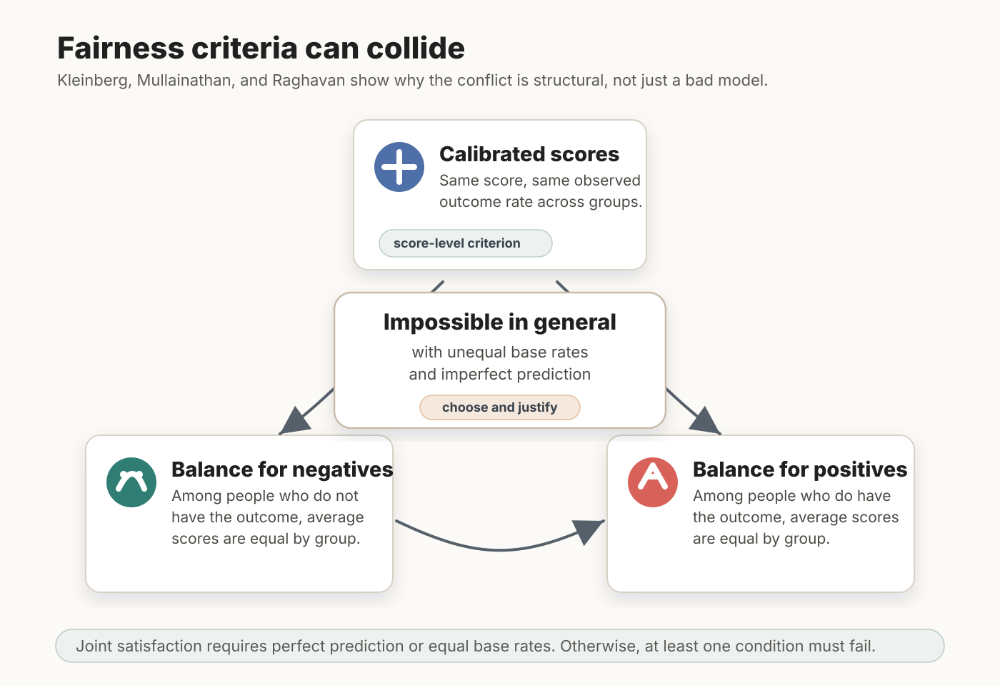
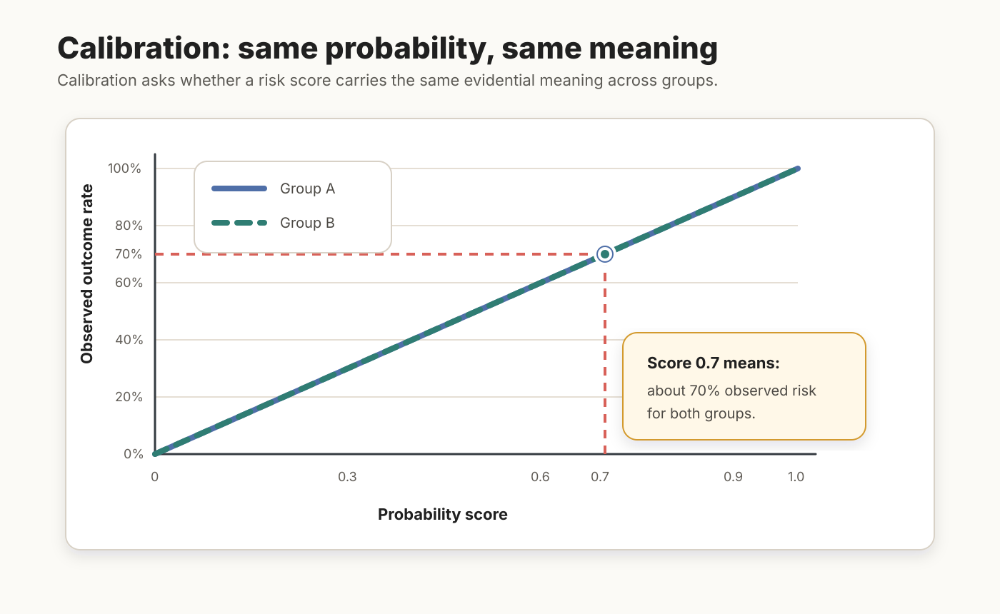
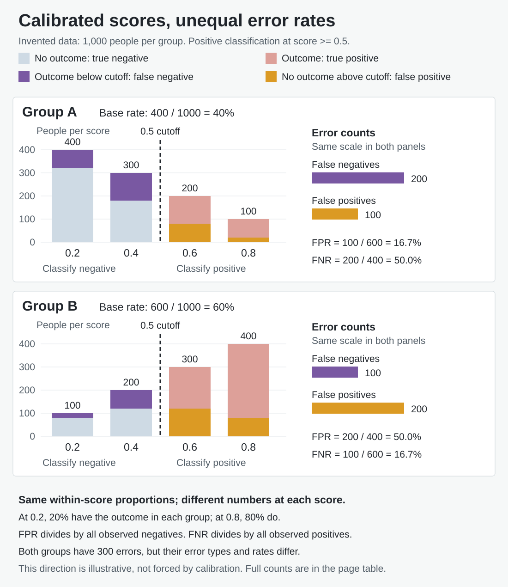

# Fairness Impossibility Results

## Core idea

[[Fairness Impossibility Results]] show that multiple plausible fairness conditions for algorithmic prediction cannot generally be satisfied at once. The foundational result currently in the vault is Kleinberg, Mullainathan, and Raghavan's theorem for risk scores: with unequal base rates and imperfect prediction, calibration within groups cannot be combined with balance for both the negative and positive classes.

Figure FIR.1 gives the basic structure. The point is not that one model happened to fail. The point is that, outside narrow special cases, some fairness demands pull against one another.

<figure class="wiki-figure" style="box-sizing: border-box;">
  
  <figcaption><strong>Figure FIR.1.</strong> Fairness criteria can collide. With unequal base rates and imperfect prediction, calibration within groups cannot generally be combined with balance for both the positive and negative classes.</figcaption>
</figure>

## Scores and decisions are different objects

Here risk scores represent probabilities; operational systems may instead use ordinal ratings that require a separate mapping to probabilities. A decision rule turns a score into an action. Let `Y = 1` mean the observed outcome occurs and `D = 1` mean the rule classifies a case as positive. A group's base rate is the fraction of its members with `Y = 1`. These distinctions determine which fairness condition we are testing.

<table>
<thead><tr><th>Condition</th><th>What is compared across groups?</th></tr></thead>
<tbody>
<tr><td>Calibration within groups</td><td>At each probability score <code>s</code>, the fraction with the outcome equals <code>s</code> in each group.</td></tr>
<tr><td>Balance for the positive class</td><td>The average score among people with <code>Y = 1</code>.</td></tr>
<tr><td>Balance for the negative class</td><td>The average score among people with <code>Y = 0</code>.</td></tr>
<tr><td>Predictive parity for a binary decision</td><td>Positive predictive value (PPV): <code>TP / (TP + FP)</code>, the outcome frequency among cases classified positive.</td></tr>
<tr><td>Error-rate parity for a binary decision</td><td>False positive rate (FPR): <code>FP / (FP + TN)</code>, and false negative rate (FNR): <code>FN / (FN + TP)</code>. Equalizing both is often called equalized odds.</td></tr>
</tbody>
</table>

The shared intuition behind calibration and predictive parity is evidential consistency. But they condition on different things: an exact score versus a positive classification that may pool many scores. Equal meaning at each score does **not** ensure equal PPV after thresholding. Equal error rates are different again, and do not by themselves mean equal numbers of errors or equal severity of harm.

Figure FIR.2 isolates calibration. On this illustrative probability scale, a score of 0.7 corresponds to a 70% outcome rate in both groups. An arbitrary ordinal risk rating of 7 out of 10 should not be assumed to mean 70% risk.

<figure class="wiki-figure" style="box-sizing: border-box;">
  
  <figcaption><strong>Figure FIR.2.</strong> Calibration within groups. A probability score matches the observed outcome frequency in each group. This is a schematic probability scale, not the COMPAS rating scale.</figcaption>
</figure>

## What the impossibility results establish

Kleinberg, Mullainathan, and Raghavan's [[Kleinberg et al., 2016|Inherent Trade-Offs in the Fair Determination of Risk Scores]] concerns the first three conditions in the table. If all three hold, either prediction is perfect or the groups have equal base rates. With unequal base rates and imperfect prediction, at least one must fail. Equal base rates remove this particular obstruction; they do not make every model fair or guarantee that all other criteria agree.

Balance conditions compare **average scores**, not the fractions crossing a chosen threshold. Replacing them with binary FPR and FNR silently changes the theorem. Score calibration and equal error rates at one particular threshold need not always be incompatible.

For binary decisions, a related conflict follows directly from the definitions. For a group with base rate `p`,

<code>PPV = p(1 - FNR) / [p(1 - FNR) + (1 - p)FPR]</code>.

If two groups have the same FPR and FNR, with FPR greater than zero and FNR less than one, different base rates produce different PPVs. Thus binary predictive parity and both error-rate equalities cannot all hold under these conditions. Degenerate cases, including no false positives, require separate treatment; perfect prediction is not the only binary exception. This argument is distinct from the score theorem. Hedden's [[Hedden, 2021|On Statistical Criteria of Algorithmic Fairness]] likewise distinguishes score-based and binary criteria.

The institutional consequence survives the distinction: attractive fairness demands can be jointly unavailable. Choosing among them requires justification, not merely improved engineering. Neither result dictates which criterion to prioritize or which group must have the higher error rate in a particular dataset.

## A worked threshold example

Figure FIR.3 uses invented data, not COMPAS observations. Each group contains 1,000 people. At every score the outcome proportion is identical across groups and matches the score. The groups differ in the number of people assigned to each score, giving base rates of 40% and 60%. The following table is the figure's complete data; "outcome" and "no outcome" are observed labels, not statements about anyone's moral character.

<table>
<thead><tr><th>Probability score</th><th>A: outcome</th><th>A: no outcome</th><th>B: outcome</th><th>B: no outcome</th></tr></thead>
<tbody>
<tr><td>0.2</td><td>80</td><td>320</td><td>20</td><td>80</td></tr>
<tr><td>0.4</td><td>120</td><td>180</td><td>80</td><td>120</td></tr>
<tr><td>0.6</td><td>120</td><td>80</td><td>180</td><td>120</td></tr>
<tr><td>0.8</td><td>80</td><td>20</td><td>320</td><td>80</td></tr>
<tr><th>Total</th><td>400</td><td>600</td><td>600</td><td>400</td></tr>
</tbody>
</table>

Classify scores of 0.5 or above as positive. Below the threshold, observed outcomes are false negatives; above it, observed non-outcomes are false positives. For example, A's 80 + 120 outcomes below the threshold give 200 false negatives. Its 80 + 20 non-outcomes above the threshold give 100 false positives. The figure's totals are sums of precisely these histogram segments, on one common count scale.

<figure class="wiki-figure" style="box-sizing: border-box;">
  
  <figcaption><strong>Figure FIR.3.</strong> Calibrated scores, unequal error rates. The within-score outcome proportions match, but the score distributions differ. Thresholding at 0.5 produces the displayed error counts and rates. The COMPAS-style direction is deliberately illustrated, not a necessary consequence of calibration or a reproduction of COMPAS data. <a href="../images/fairness-impossibility-results/threshold-error-burdens.svg">View full-size figure</a>.</figcaption>
</figure>

<table>
<thead><tr><th>Quantity</th><th>Group A</th><th>Group B</th></tr></thead>
<tbody>
<tr><td>True positives (TP)</td><td>200</td><td>500</td></tr>
<tr><td>False positives (FP)</td><td>100</td><td>200</td></tr>
<tr><td>True negatives (TN)</td><td>500</td><td>200</td></tr>
<tr><td>False negatives (FN)</td><td>200</td><td>100</td></tr>
<tr><td>FPR: mistakes among observed negatives</td><td>100 / 600 = 16.7%</td><td>200 / 400 = 50.0%</td></tr>
<tr><td>FNR: mistakes among observed positives</td><td>200 / 400 = 50.0%</td><td>100 / 600 = 16.7%</td></tr>
<tr><td>PPV: outcomes among predicted positives</td><td>200 / 300 = 66.7%</td><td>500 / 700 = 71.4%</td></tr>
</tbody>
</table>

Do not divide an error count by the height of its score bar to obtain FPR or FNR: those denominators contain **all** observed negatives or positives in the group. Nor does comparing FP with FN establish error-rate parity; they have different denominators. Here both groups have 300 total errors, yet the types and rates differ substantially.

The base rate is a weighted average of the bin outcome rates. Calibration alone fixes neither the bin sizes nor the direction of the error disparity. In this chosen example A has more false negatives and B more false positives, in both count and rate comparisons. Other calibrated score distributions can yield other patterns. The unequal PPVs also demonstrate why calibration must not be renamed binary predictive parity.

The score theorem is visible in the same data without choosing any threshold. Among observed positives, the mean score is 0.500 in A and 0.667 in B; among observed negatives, it is 0.333 in A and 0.500 in B. Calibration holds, but neither average-score balance condition does. These means and the thresholded error rates are separate calculations.

## Evidence and debate

The formal results explain why the COMPAS debate could not be resolved by simply declaring one metric to be fairness itself. ProPublica-style error-rate critiques and calibration defenses address different questions. They must also be tested against the actual data: an impossibility theorem neither validates COMPAS nor excuses any particular disparity.

One response is to give calibration a special status. It preserves the evidential meaning of a score across groups, and Hedden argues that many non-calibration criteria are not necessary for fair prediction. His coin-and-rooms example in [[Hedden, 2021|On Statistical Criteria of Algorithmic Fairness]] is meant to show that a fair and uniquely optimal predictor can violate error-rate and statistical-parity criteria even when base rates are equal.

The competing response is to emphasize error burdens. Preserving evidential meaning is not enough if action, treatment, and legal burden depend on mistakes. Hellman develops this distinction in [[Hellman, 2020|Measuring Algorithmic Fairness]], emphasizing the balance between error types and their consequences. Her error-ratio argument should not be collapsed into a demand that FPR and FNR each be equal across groups.

The broader lesson is that impossibility results create philosophical work rather than merely technical work. If metrics conflict, the appropriate response is to ask which egalitarian, anti-discrimination, or representational ideal should govern the domain. Binns develops that normative turn in [[Binns, 2018|Fairness in Machine Learning: Lessons from Political Philosophy]].

The result also sets up later normative readings. Once the metrics conflict, the next question is not only "which metric is mathematically correct?" but "which error, burden, right, or institutional goal should govern this setting, and is the unfairness in the prediction, the decision rule, or the surrounding institution?"

## Practical or policy relevance

For digital nudging, impossibility results are a warning against treating fairness as a post-hoc technical patch. If recommender systems, targeting engines, predictive models, or eligibility scores optimize one fairness criterion, they may worsen another. Designers and regulators need an explicit account of the decision context, the affected parties, and the cost of different errors.

## Related pages

- [[Kleinberg et al., 2016|Inherent Trade-Offs in the Fair Determination of Risk Scores]]
- [[Hedden, 2021|On Statistical Criteria of Algorithmic Fairness]]
- [[Hellman, 2020|Measuring Algorithmic Fairness]]
- [[Binns, 2018|Fairness in Machine Learning: Lessons from Political Philosophy]]
- [[Algorithmic Fairness]]

## Open questions

How should this page incorporate later impossibility results and critiques without turning into a purely technical taxonomy?
