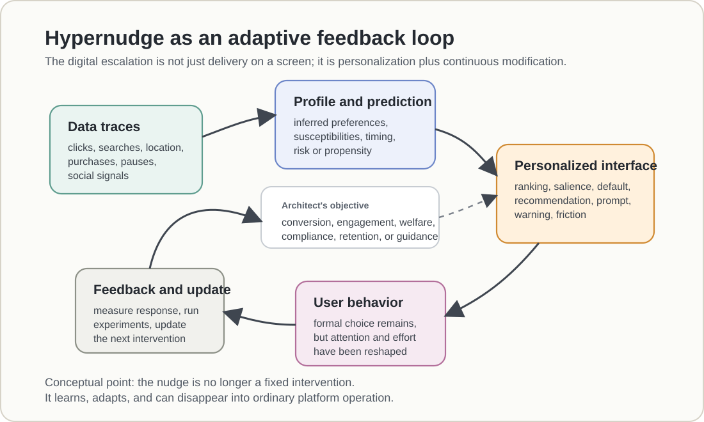

# Hypernudge

## Core idea

[[Hypernudge]] is Karen Yeung's term for Big Data-driven digital decision-guidance systems that configure a user's informational [[Choice Architecture]] in personalized, dynamic, continuously updated ways. A hypernudge leaves the user as the formal decision-maker, but shapes the environment of attention, salience, ranking, and recommendation in directions preferred by the choice architect. [[Yeung, 2017|Hypernudge: Big Data as a Mode of Regulation by Design]] is the foundational source for the concept.

The concept is foundational for [[Digital Nudging]] because it identifies what is new about digital nudging: not merely that nudges occur on screens, but that they can be driven by data, algorithms, personalization, and feedback loops.

The same digital capacities are ethically ambivalent. Personalization, feedback, and prediction can enable opaque behavioral control, but they can also be redirected toward user-serving thought partnership, adaptive protection, and debiasing. Ludwig and coauthors' [[Ludwig et al., 2025|Algorithms as a Vehicle to Reflective Equilibrium: Behavioral Economics 2.0]] is the constructive counterpoint to Yeung's warning.

## Distinguishing features

- Networked: the nudge operates in connected digital environments that collect and exchange data.
- Personalized: the choice environment is tailored to a user's profile, behavior, inferred preferences, and context.
- Dynamic: the intervention can change as the user and environment change.
- Continuously updated: the system can refine rules and prompts through ongoing feedback.
- Pervasive: the intervention can operate across everyday digital services.
- Opaque: the mechanism may be hidden in models, rankings, platform experiments, or proprietary systems.
- Scalable: a single system can shape the informational environment of millions of people.

## Mechanism

Hypernudging works as a self-contained cybernetic system: it gathers information, sets or updates standards, modifies behavior through the choice environment, observes the response, and feeds the result back into the system. Yeung's account is the anchor for this feedback-loop model.

Figure HN.1 makes the mechanism explicit. The distinctive point is not that a digital system can deliver a familiar nudge, but that behavioral traces can be converted into predictions, predictions into personalized choice architecture, and user responses into the next round of intervention.

<figure class="wiki-figure" style="box-sizing: border-box;">
  
  <figcaption><strong>Figure HN.1.</strong> Hypernudge feedback loop. Data traces feed profiles and predictions, which shape personalized rankings, prompts, defaults, recommendations, warnings, or friction; user behavior then becomes feedback for the next intervention.</figcaption>
</figure>

The central mechanism is informational choice architecture. Search rankings, feeds, recommendations, navigation suggestions, and predictive prompts determine which options are visible, salient, credible, easy, or framed as relevant.

## Continuous optimization and experimentation

The former concept of continuous optimization and experimentation now lives here. Hypernudges become powerful because they can be repeatedly modified as data arrive. A/B tests, bandit systems, recommender updates, ranking changes, and live interface experiments let a platform learn which variant changes behavior, then redeploy the winning design at scale.

This capacity is ethically ambivalent. It can improve guidance, timing, and relevance. It can also make manipulation more precise, because the architect can optimize for engagement, conversion, retention, or data extraction without measuring chooser welfare.

### Worked example: testing a subscription recommendation

Consider a hypothetical service offering monthly and annual subscriptions. Version A presents both with equal prominence. Version B highlights the annual plan and labels it "Recommended," while leaving prices and alternatives unchanged. The annual plan is cheaper for sustained use but less suitable for someone likely to leave after one month. This is a teaching example with invented numbers, not a finding from one of the sources.

Randomly assign 2,000 eligible visitors, once per user, to each version. Keep prices, traffic sources, eligibility, and the observation window comparable. Define the main outcome in advance as an annual purchase within seven days, measured among **all assigned visitors**, not only those who complete checkout.

Before testing, check that both variants meet basic requirements for truthful presentation, meaningful refusal, and appropriate research and privacy safeguards. Randomization makes an effect easier to identify; it does not make exposing people to a harmful design ethically permissible.

| Seven-day outcome | A: equal prominence | B: annual plan highlighted |
| --- | ---: | ---: |
| Visitors assigned | 2,000 | 2,000 |
| Annual purchases | 200 | 260 |
| Annual purchase rate | 10% | 13% |

The estimated effect is **3 percentage points**, or a **30% relative increase** over A. Under an independent-user, large-sample calculation, the approximate 95% confidence interval for the difference is 1.0 to 5.0 percentage points. Randomization supports a causal interpretation of assignment to the complete interface variant, assuming it was implemented correctly and users did not affect each other's treatment. It does not isolate whether the label, visual prominence, or their combination caused the increase. It also does not establish a durable effect outside this population and period.

The measured gain is conversion, not welfare. To evaluate the latter, collect evidence about understanding of the annual commitment, total spending, actual use, later endorsement or regret, refund requests, and the ability to cancel. Define the horizons and comparison rules before inspecting results. Follow all assigned users where feasible: comparing regret only among buyers conditions on a group whose composition the treatment itself changed. Missing survey responses, unequal follow-up, and subgroup differences also need attention. Few cancellations may mean satisfaction, or difficulty cancelling; the count alone cannot decide.

Suppose B increases annual purchases but leaves users less able to explain renewal terms. The experiment would then reveal a behavioral gain alongside an agency concern, not establish a successful welfare intervention. Conversely, more purchases accompanied by better comprehension and later endorsement would support, without conclusively proving, a user-serving interpretation. An increase in spending might be good for regular users and harmful for occasional ones. A single average cannot settle that distributional question.

An ordinary fixed A/B test is not yet a hypernudge. The transition occurs when the service uses continuing feedback and user profiles to decide which recommendation to show to whom, revises that rule, and repeats the process. Validation then has to follow the changing policy: retain an appropriate control, record version and assignment histories, monitor subgroup outcomes, and use an analysis suited to repeated or adaptive testing. Repeatedly checking a conventional significance test and stopping at the first favorable result is not equivalent to the fixed experiment above.

The substantive distinction is between learning what changes behavior and deciding which change deserves to be optimized. Yeung supplies the account of adaptive steering; Schmidt and Engelen connect that capacity to ethical scrutiny. The [[Behavior-Welfare Gap]], developed by Kleinberg and coauthors in [[Kleinberg et al., 2023|The Challenge of Understanding What Users Want]], explains why even a well-run experiment needs more than an engagement or conversion target.

## Ethical stakes

Hypernudging intensifies the usual ethics of nudging. A static default or prompt can be inspected and debated. A hypernudge may be personalized, experimental, and invisible to the user. It may also optimize for engagement, revenue, data extraction, or institutional convenience rather than [[Chooser Welfare]].

The connection to [[Libertarian Paternalism]] is therefore a test, not an equivalence. Retaining the final click does not establish meaningful freedom, and personalization does not establish benefit by the user's own lights. Applying that standard to a changing system requires examining whether its objective remains user-serving and whether users can still understand and reject its steering as it adapts. This is the course's normative application of the hypernudge account.

Schmidt and Engelen's [[Schmidt and Engelen, 2020|The Ethics of Nudging: An Overview]] helps mark why this becomes a new ethics problem rather than only a new delivery channel. Digital choice architecture can combine user data, A/B testing, algorithms, personalization, and opacity, so freedom to choose otherwise may exist formally while users lack practical understanding or control over the architecture shaping the choice.

This makes [[Transparency and Disclosure]], [[Privacy and Consent]], [[Algorithmic Fairness]], and [[Manipulation]] central to the concept.

The positive-potential question is whether hypernudge-like infrastructure can be governed so that it functions as user-serving thought partnership or adaptive armor ([[Algorithmic Thought Partners]]) rather than opaque behavioral control.

## Related pages

- [[Personalized Choice Architecture]]
- [[Algorithmic Thought Partners]]
- [[Recommendation Systems]]
- [[Dark Patterns]]
- [[Privacy and Consent]]
- [[Algorithmic Fairness]]
- [[Digital Nudging]]

## Open questions

When does adaptive, personalized guidance remain a helpful digital nudge, and when does it become an opaque form of behavioral control?
